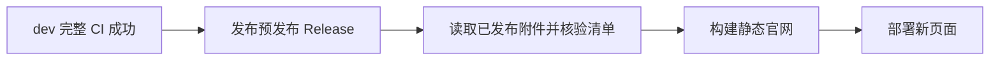

# LeaguePingo 下载官网方案

状态：2026-11-17，W1/W2及W3代码已实施；Pages上线状态以[官网说明](WEBSITE.md)及具体Actions部署结果为准。以下保留原方案，独立域名/国服线路/CDN尚未完成。

## 目标与现有基础

让腾讯国服玩家看懂助手的用途，并在首屏直接下载正确的 Windows 程序。官网负责介绍与分发，玩家查询和客户端连接仍在本地助手中完成。

现有基础：Windows amd64 桌面产品、C款品牌图标、炭灰/紫色深色界面、客户端外侧栏、加载/局内快览、战绩与双方详情、海克斯攻略，以及独立可选自动化。当前已有按提交生成的 GitHub 预发布版本，附件包含 EXE、安装器、构建说明、校验值和使用说明；没有正式稳定版。

设计遵循 [AGENTS.md](../AGENTS.md) 中的原文：

> Avoid unnecessary secondary labels and descriptions. Let the layout do the explaining.

## 页面结构

推荐一页官网，使用“下载 → 看实际界面 → 了解安装与使用”的顺序。主页面不做功能目录式的密集卡片墙。

| 区域 | 内容与排版 | 用户获得的信息 |
| --- | --- | --- |
| 顶部导航 | 左侧现有品牌标志；右侧“功能、更新日志、帮助”和下载入口 | 知道产品是谁，随时能下载 |
| 首屏 | 左侧短标题、一句介绍、一个主下载按钮；右侧大幅展示当前产品界面，约占内容宽度60% | 看懂用途并立即下载 |
| 对局过程演示 | “赛前 / 局内 / 复盘”切换同一展示区域；无脚本时仍显示默认画面 | 看懂侧栏、快览和双方详情各在何时使用 |
| 海克斯攻略 | 单独一段，一侧可读的强化/出装界面局部，一侧一句用途描述 | 突出国服用户优先关心的模式 |
| 开始使用 | 下载、安装或直接运行、登录客户端三步横排；手机纵排 | 知道安装后怎么开始 |
| 更新与帮助 | 最近一版的简短更新摘要；安装、连接、退出旧版、下载失败等问题按需展开 | 下载前后遇到问题有明确去处 |
| 页尾 | GitHub、历史版本、反馈、隐私与第三方声明 | 获取支持和必要归属信息 |

首屏文案建议：

```text
LeaguePingo

看清对局，再进峡谷
面向腾讯国服的本地助手，赛前资料、局内快览与赛后复盘。

[下载 Windows 测试版]     免安装版
Windows 64 位 · 版本号 · 发布日期
```

主按钮下载安装器，旁边的普通文字链接下载可直接运行的 EXE。版本和日期从同一发布清单生成；完整提交、校验值、历史版本放在展开区域或更新日志，不堆在首屏。将来有稳定版时，默认展示稳定版，测试版保留独立入口；当前只有测试版，按钮明确写“测试版”。

## 视觉与交互

- 延续现有品牌图标、炭灰底色和紫色主要按钮。官网用更大的标题、截图和间距，产品截图保持自身界面样式。
- 采用产品演示为主的方向：LeaguePingo在客户端外侧、载入画面和复盘界面中的实际位置，组成页面的展示顺序；画面本身说明用途。
- 一个主要交互是对局阶段切换。显示当前版本的真实界面截图或短演示，不在网页调用LCU或查询玩家；不制作无法在助手中找到的“功能演示”。
- 不为每段增加“核心能力”“专业体验”等小标签，不重复解释标题，不伪造下载量、评价、评分提升或零性能开销。支持范围和当前测试版状态是必要信息，仍应明确。
- 实施时重新采集已验证版本的界面，使用合成账号或匿名演示数据，统一裁切、分辨率和主题。现有截图可作布局参考，不能把历史开发截图直接当成当前能力。
- 1440、1280、768、390像素分别检查；移动端先显示标题与下载入口，再显示可读的界面局部，不把整张桌面窗口缩成小图。
- 手机和macOS访客仍能查看介绍与复制下载链接，只简短说明程序适用于Windows；没有对应安装包时不展示虚假的平台按钮。
- 下载是真实链接，不依赖JavaScript；焦点可见、触控目标足够大，交互支持键盘和减少动态效果。没有真实录像时不强加自动播放视频。

## 站点与下载实现

首期推荐 **Astro静态输出 + GitHub Pages + 现有GitHub Releases**。独立放在 `website/`，不依赖Wails绑定、桌面运行时或玩家数据接口；项目现有品牌资源按需复用。站点只需少量JavaScript完成演示切换，主体文字和下载链接在HTML中直接可用。

选择静态站的原因：没有账号系统、业务数据库或长期运行的服务器；适合官网搜索收录和分享，发布成本低。初次启用Pages需核对仓库可用性和权限；先用托管域名预览，再绑定用户持有的独立域名。域名尚未选定，本方案不假定已购买或已配置。

下载清单应包含：渠道、产品版本、Release标签、完整提交、发布日期、发布页面、EXE/安装器链接与大小、SHA-256和精简更新摘要。构建时生成静态JSON与HTML，不把GitHub令牌放在浏览器。

发布链路建议：



关键处理：

1. 当前发布脚本使用 `GITHUB_TOKEN`，不要只依靠另一个工作流的 `release: published` 事件触发网站更新；该令牌产生的事件通常不会启动后续工作流。优先在现有CI的release任务成功后显式接续网站任务，同时更新现有工作流策略与回归。
2. 从Releases列表区分稳定版和预发布版，排除草稿；按发布日期选取符合渠道和附件条件的版本。不能使用只返回正式版的 `/releases/latest` 来找当前测试版，也不能按包含提交号的标签字符串排序。
3. 从真实附件对象读取URL，核对附件名、上传状态、大小、摘要与BUILD-INFO中的提交。缺少安装器或校验不符时，不更新主下载入口。
4. 站点任务只拥有所需的Pages部署权限，不能获得发布软件的写权限。发布脚本与构建任务的现有权限隔离继续保留；不改main或默认分支。
5. 软件发布失败不更新网页；网页构建或部署失败保留上一份可用页面，软件Release本身仍可下载。页面保留“历史版本 / GitHub下载”入口。
6. 站点纯内容修改应支持只检查和部署网站，复用最近已验证的下载清单，不为修改介绍文案重新编译桌面程序。实施时明确路径筛选与依赖，避免把当前“每次dev推送发布软件”规则悄悄改掉。
7. 首页、图片和下载清单作为同一次站点构建部署，防止新版本号配上旧下载链接。GitHub Pages项目路径与自定义域名路径均需验证。

## 面向国服玩家的分发

首期下载指向GitHub Releases，不需要自建文件服务器；但官网能打开，不代表GitHub大文件下载在国内各线路都稳定。上线前分别测试网页和EXE下载的实际可达性、失败率与耗时。

如果面向更广泛的国内用户，下一阶段增加对象存储/CDN下载源：只同步已发布且哈希验证通过的同一批附件，按版本不可变路径保存；镜像未就绪时继续保留原下载源，不显示失效链接。页面可提供简短的备用下载入口，不能静默跳转到未知第三方代理。国内加速所需的域名、服务开通条件和费用在选定托管服务时确认，不预先承诺可达性或速度。

## 实施批次与验收

| 批次 | 交付 | 验收重点 |
| --- | --- | --- |
| W1 页面与内容 | 首屏、产品演示、海克斯展示、安装帮助，桌面/手机预览 | 五秒内看懂用途；首屏有下载；截图清晰；无无用重复说明 |
| W2 版本与下载 | 真实发布清单、安装器与EXE按钮、渠道和历史版本 | 仅测试版、已有稳定版、附件缺失、上游不可用、页面脚本禁用均能正确处理 |
| W3 自动发布与上线 | Release后的站点部署、托管域名、可选自定义域名、分享预览 | 版本与附件哈希一致；失败保留旧站；手机、键盘、国内网页及下载线路实测 |
| W4 可选分发增强 | 经测量确认需要后接对象存储/CDN | 原版与镜像哈希一致、失败回退、费用与存储生命周期明确 |

W1–W3构成首期完整官网，W4由实际下载体验决定。首期不引入账号、订阅、在线玩家数据库或营销后台。页面视觉与文案先独立预览，再接入正式发布链路。静态托管可使用服务商免费额度，独立域名、对象存储与CDN费用按所选服务和实际流量另计。实施后实际验证与上线状态见WEBSITE.md；原方案不作为已验收证据。
